

<!-- ANIMATED HEADER -->

<!-- TYPING ANIMATION -->

<!-- PROFILE VIEWS & SOCIAL BADGES -->

  
  
  
  <!--
  
  -->

<!-- ─────────────── ABOUT ─────────────── -->

  

<!-- ─────────────── STACK ─────────────── -->

#### `▸ hyperledger`

#### `▸ blockchain`

#### `▸ languages`

#### `▸ frontend`

#### `▸ backend`

#### `▸ tools & platforms`

<!-- ─────────────── STATS ─────────────── -->

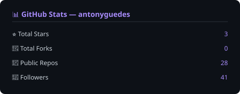


<!-- ─────────────── TROPHIES ─────────────── -->

  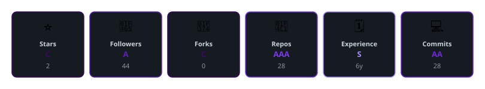

<!-- ─────────────── CONTRIBUTIONS ─────────────── -->

  <picture>
    <source media="(prefers-color-scheme: dark)" srcset="https://raw.githubusercontent.com/antonyguedes/antonyguedes/output/github-snake-dark.svg" />
    
  </picture>

<!-- FOOTER -->
